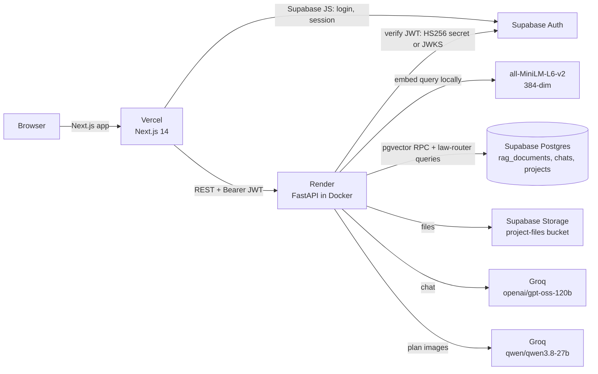

# Rule VII — AI Architectural Mentor

An AI assistant that answers architectural and building-code questions for the Philippines. It cites the exact law and section behind every answer, checks floor plans for compliance, and drafts proposal sections the user can edit and export as a PDF report.

| | |
|---|---|
| **Live app** | https://rule-vii-frontend.vercel.app |
| **API** | https://rule-vii-backend.onrender.com (`/health`, `/docs`) |
| **Repo** | https://github.com/migsrvr/Rule-VII---AI-Architect |
| **Status** | Deployed (Oct 2026). Production code is on branch `deploy-fixes` (not yet merged to `main`) |

> The backend runs on Render's free plan, so it sleeps after 15 minutes idle. The first request after that takes about 30–60 seconds while it wakes up.

---

## Portfolio summary

Everything in this section is factual and checked against the code and the live deployment, so a portfolio writer can use it directly.

**One-liner:** A retrieval-augmented (RAG) AI mentor for Philippine architects and students. It grounds every answer in a 7,273-chunk vector database of 31 Philippine building laws, codes and ordinances.

**Problem:** Philippine building regulations are spread across dozens of laws, implementing rules (IRRs), department orders and local zoning ordinances. Architects and students lose time finding the clause that applies to a specific design question. General-purpose chatbots also tend to make up citations.

**Solution:**
- **Grounded answers.** Answers come with citations: source document, law code and section.
- **Three modes.** Quick Answer, Compliance Check and Plan Draft, each tuned for retrieval depth and accuracy.
- **Plan analysis.** Upload a floor plan (image or PDF) and a vision model reviews it.
- **Drafting workspace.** AI-drafted sections can be approved, revised with AI help, edited by hand and exported as a PDF compliance report.
- **Projects.** Each project keeps its own uploaded files and chat history.

**Technical highlights:**
- **Hybrid retrieval.** pgvector semantic search, plus a keyword-based **law router** (250+ rules) that detects intent (fire safety → RA 9514, accessibility → BP 344, condominiums → PD 957, and so on) and pulls those laws in directly.
- **Per-mode tuning.** Each mode has its own number of results, similarity threshold, document-type filter and temperature. Compliance mode uses temperature 0.1 for factual accuracy.
- **Modern auth.** Supabase Auth with JWT verification on the backend, supporting both legacy HS256 and asymmetric ES256/RS256 signing keys via the project's JWKS endpoint.
- **Free-tier infrastructure.** Vercel (frontend), Render free plan (backend in Docker), Supabase free tier (Postgres + pgvector + Auth + Storage) and Groq (fast hosted LLMs).
- **Self-hosted embeddings.** `all-MiniLM-L6-v2` (384 dimensions) is baked into the Docker image, so embedding costs nothing per query and the model doesn't download at startup. Peak RAM was measured at about 467 MB, inside the 512 MB free-plan limit.

**Engineering challenges solved during deployment** (good material for a case study):
1. **A missing module in the repo.** A Python `lib/` rule in `.gitignore` silently kept `frontend/src/lib/` (API client, Supabase client, types) out of git. The app worked on the developer's machine but couldn't be built from a fresh clone. The module was rebuilt from its usage and the rule was narrowed.
2. **Frontend hardcoded to localhost.** The frontend called `http://localhost:8000` directly. This was replaced with an environment-driven API client.
3. **Retired models.** Groq retired both original models (Llama 3.3 70B for chat, Llama 4 Scout for vision). They were replaced with `openai/gpt-oss-120b` and `qwen/qwen3.8-27b`. The new chat model reasons before answering, and with the original token limits that reasoning used the whole budget and **returned empty replies**. The fix was low reasoning effort plus a dedicated token allowance for reasoning.
4. **Auth signing-key migration.** Supabase moved the project to ES256 signing keys, but the backend only verified HS256. JWKS-based verification was added, with 8 security test cases including forged, expired, wrong-audience and `alg=none` tokens.
5. **Production Docker hardening:**
   - Secrets were being copied into the image; `.env` is now excluded.
   - CPU-only PyTorch keeps the image small.
   - The server binds to the host-provided `$PORT`.
   - Proxy headers are enabled so per-IP rate limiting works behind Render's load balancer.

**Assets for the portfolio:**
- **Screenshots:** none in the repo. Capture them from the live app: landing page, the `/dashboard/new` workspace with chat and document panel, a compliance-check answer with citations, and an exported PDF report.
- **Visuals:** `frontend/public/hero-image.png` and `frontend/public/logo.svg`.
- **Timeline:** first commit 2025-12-17. Active development through 2026, deployed October 2026.

**Don't claim:**
- **Fine-tuning:** `fine-tuning/` has a notebook scaffold but the dataset is empty, so no fine-tuned model is in use.
- **Ingestion pipeline:** `data-pipeline/ingest.py` is a stub. The data was ingested outside the repo (LlamaParse → chunking → embeddings → Supabase).
- **Reports page:** `/dashboard/reports` is a UI prototype with sample data. Real reports are exported as PDFs from the workspace.
- **ADA, Gemini, Whisper and voice input:** none of these are implemented. They were in older planning docs.

---

## Features

| Feature | Status | Where |
|---|---|---|
| Email/password signup and login, password reset email | ✅ Live | `frontend/src/app/{login,signup,forgot-pass}` |
| AI chat with code citations (3 modes) | ✅ Live | `/dashboard/new`, `backend/app/api/v1/chat.py` |
| Floor-plan analysis (PNG/JPG, or the first page of a PDF) | ✅ Live | `backend/app/api/v1/analyze.py` |
| Chat history, favorites, delete | ✅ Live | sidebar in `/dashboard/new` |
| Draft proposals: approve, AI revise, manual edit | ✅ Live | `frontend/src/components/workspace/` |
| Export document as PDF (html2pdf) | ✅ Live | `DocumentPanel.tsx` |
| Projects CRUD with file uploads (Supabase Storage) | ✅ Live | `/dashboard/projects` |
| Project-aware chat (project name, location, description and uploaded file names used as context) | ✅ Live | `chat.py` |
| Saved reports page | 🟡 UI prototype (sample data) | `/dashboard/reports` |
| Password update page after reset link | ❌ Missing (`/update-password` doesn't exist yet) | — |
| Auth error page | ❌ Missing (`/auth/auth-code-error` doesn't exist yet) | — |
| Voice input, Deep Thinking mode, pricing tiers | 📝 Planned only | `docs/planning/` |

### Chat modes

| Mode | Purpose | Retrieved chunks | Similarity threshold | Temperature | Answer tokens |
|---|---|---|---|---|---|
| **Quick Answer** | Fast general answers | 6 | 0.30 | 0.2 | 800 |
| **Compliance Check** | Verdict-style check against the code | 10 | 0.25 | 0.1 | 1500 |
| **Plan Draft** | Long-form drafting of plan sections | 8 (statutory, procedural, specialized planning only) | 0.30 | 0.3 | 1200 |

Configuration lives in `RAGEngine.MODE_CONFIG` (`backend/app/services/rag_engine.py`) and `MODE_MAX_TOKENS` / `MODE_PROMPTS` (`backend/app/services/llm_engine.py`). Every request also gets 1,024 extra tokens for the model's hidden reasoning (`REASONING_TOKEN_HEADROOM`).

---

## Architecture



**Chat request flow** (`POST /api/v1/chat/`):
1. The frontend sends the message, mode, conversation ID and project ID, with the Supabase access token attached (`frontend/src/lib/api-client.ts`).
2. `verify_token` checks the JWT (`backend/app/core/security.py`).
3. The user message is saved. If this is a new conversation, a `sessions` row is created first.
4. `RAGEngine.retrieve`:
   - Embeds the query.
   - Runs the `search_documents` or `search_documents_filtered` RPC.
   - The law router adds chunks from the laws it detected (hybrid search).
5. If a project is linked, its name, location, description and uploaded file names are added to the context.
6. `LLMEngine.generate` calls Groq with a mode-specific system prompt and the retrieved, labeled sources.
7. The answer is saved and returned with `sources[]` (document, section, law code, similarity) and an optional `proposal`.

---

## Tech stack

| Layer | Technology | Hosting |
|---|---|---|
| Frontend | Next.js 14 (App Router), React 18, TypeScript, Tailwind, shadcn/ui (Radix), Framer Motion, GSAP | Vercel |
| Backend | FastAPI, Python 3.11, Pydantic v2, slowapi (rate limiting), PyMuPDF | Render (Docker, free plan) |
| Database | Supabase Postgres + pgvector | Supabase |
| Auth | Supabase Auth (email/password), JWT verified in the backend (HS256 + ES256/RS256 via JWKS) | Supabase |
| File storage | Supabase Storage, bucket `project-files` | Supabase |
| LLM (chat) | `openai/gpt-oss-120b`, reasoning effort low | Groq |
| LLM (vision) | `qwen/qwen3.8-27b` | Groq |
| Embeddings | `sentence-transformers/all-MiniLM-L6-v2` (384-dim), CPU | Inside the backend container |

---

## Knowledge base (RAG dataset)

**31 documents, 7,273 chunks** in the `rag_documents` table, as of Oct 2026. Each chunk has `content`, `embedding` (384-dim), `source`, `law_code`, `document_type` (`statutory` / `procedural` / `specialized_planning`), `section_ref` and `chunk_index`.

| Area | Documents (law code) |
|---|---|
| Building & fire | PD 1096 National Building Code + Revised IRR (2004), RA 9514 Fire Code Revised IRR (2019), Philippine Green Building Code |
| Accessibility & sanitation | BP 344 Accessibility Law, PD 856 Sanitation Code |
| Housing | PD 957 (Subdivisions and Condominiums) IRR, BP 220 (Socialized Housing) IRR, RA 7279 (UDHA) |
| Professional practice | RA 9266 Architecture Act, RA 544 Civil Engineering, RA 8495 Mechanical Engineering, NBCDO MC 1 s. 2025 |
| Permits & procurement | JMC 2018-01 (Building Permits), RA 11032 (Ease of Doing Business) IRR, RA 12009 (New Procurement Act), GPPB Res. 02-2025, JMC 2023-003 & 2025-001 (Price Ceilings) |
| DPWH / DOLE orders | DPWH DO 48 s. 2024, DO 127 s. 2023, DO 131 s. 2025, DO 166 s. 2024; DOLE DO 13 (Construction Safety) |
| General law | RA 386 Civil Code, RA 7160 Local Government Code, RA 9285 ADR Act, RA 10066 Heritage Act |
| Local zoning | Makati Zoning, Manila Ord. 8119, Taguig Ord. 15-2003 |

The largest sources are RA 9514 IRR (2,632 chunks) and PD 1096 IRR (1,426 chunks). The SQL for the tables and search functions is in `backend/database/`. `backend/scripts/rag_data_audit.py` audits the dataset.

---

## Project structure

```
Rule-VII---AI-Architect/
├── frontend/                      # Next.js 14 app (deployed to Vercel)
│   ├── src/app/                   # Routes: /, /login, /signup, /forgot-pass, /auth/callback,
│   │                              #   /dashboard, /dashboard/new (workspace), /dashboard/projects, /dashboard/reports
│   ├── src/components/
│   │   ├── chat/                  # ChatInterface, InputArea (mode picker, uploads), MessageBubble, ThoughtStream
│   │   ├── workspace/             # DocumentPanel (PDF export), DraftBubble, RevisionModal, RevisionProposalMessage
│   │   ├── layout/                # Header, Sidebar
│   │   └── ui/                    # shadcn/ui + animation components
│   ├── src/lib/                   # api-client.ts (axios + JWT), api-types.ts, supabase.ts, utils.ts
│   ├── src/middleware.ts          # Supabase session refresh
│   └── vercel.json                # Pins framework = nextjs
├── backend/                       # FastAPI API (deployed to Render via Docker)
│   ├── app/main.py                # App, CORS, routers
│   ├── app/core/                  # config.py (env), security.py (JWT/JWKS), database.py (Supabase client)
│   ├── app/api/v1/                # chat, analyze, projects, project_files, users, rag, auth (webhook)
│   ├── app/services/              # rag_engine.py (retrieval + law router), llm_engine.py, vision_engine.py
│   ├── database/                  # SQL: chat schema, law library schema, search functions
│   ├── scripts/                   # rag_data_audit.py
│   └── Dockerfile
├── render.yaml                    # Render Blueprint for the backend (free plan, Singapore)
├── data-pipeline/                 # Ingestion scaffold (stub; real ingestion was done outside the repo)
├── fine-tuning/                   # Llama 3 fine-tuning scaffold (unused, empty dataset)
├── docs/planning/                 # Design notes: RAG revisions, deep thinking, voice input, pricing
├── docker-compose.yml             # Local dev stack (hot reload)
└── Makefile                       # Dev shortcuts
```

---

## Local development

**Prerequisites:**
- Node.js 20+ and Python 3.11+, or just Docker.
- A Supabase project with `backend/database/*.sql` applied, a `project-files` storage bucket, and the knowledge base loaded.
- A Groq API key.

### Environment variables

`backend/.env` (read from the `backend/` folder):
```env
SUPABASE_URL=https://<project>.supabase.co
SUPABASE_SERVICE_ROLE_KEY=<service-role key>     # server only, never expose
SUPABASE_JWT_SECRET=<legacy JWT secret>          # still used for HS256 tokens
GROQ_API_KEY=<groq key>
DEBUG=True                                       # False in production
FRONTEND_URL=http://localhost:3000               # production: https://rule-vii-frontend.vercel.app
# Optional / unused: SUPABASE_WEBHOOK_SECRET, HUGGINGFACE_TOKEN, RUNPOD_API_KEY
```

`frontend/.env.local` (or `frontend/.env`):
```env
NEXT_PUBLIC_API_URL=http://localhost:8000
NEXT_PUBLIC_SUPABASE_URL=https://<project>.supabase.co
NEXT_PUBLIC_SUPABASE_ANON_KEY=<anon key>         # public by design; RLS protects data
```

### Run

```bash
# With Docker (frontend :3000, backend :8000, API docs :8000/docs)
docker-compose up

# Or without Docker
cd backend && python -m venv venv && source venv/bin/activate   # venv\Scripts\activate on Windows
pip install -r requirements.txt && uvicorn app.main:app --reload

cd frontend && npm install && npm run dev
```

Before pushing, run `cd frontend && npm run build`. The production build checks some things `npm run dev` doesn't, such as Suspense boundaries around `useSearchParams` and type errors.

---

## Deployment

| Piece | Platform | How it deploys | Config |
|---|---|---|---|
| Frontend | Vercel, project `rule-vii-frontend` | Vercel CLI from `frontend/` (`npx vercel deploy --prod`). Not connected to git yet | `frontend/vercel.json`, env vars in the Vercel dashboard |
| Backend | Render, service `rule-vii-backend` (free, Singapore) | Blueprint `render.yaml`, auto-deploys on push to `deploy-fixes` | `backend/Dockerfile`, secrets in the Render dashboard |
| Database / Auth / Storage | Supabase | Managed | Site URL + redirect `https://rule-vii-frontend.vercel.app/auth/callback` |

**Production env:**
- **Vercel:** `NEXT_PUBLIC_API_URL=https://rule-vii-backend.onrender.com`, `NEXT_PUBLIC_SUPABASE_URL`, `NEXT_PUBLIC_SUPABASE_ANON_KEY`.
- **Render:** `SUPABASE_URL`, `SUPABASE_SERVICE_ROLE_KEY`, `SUPABASE_JWT_SECRET`, `GROQ_API_KEY`, `FRONTEND_URL=https://rule-vii-frontend.vercel.app`, `DEBUG=False`.

`NEXT_PUBLIC_*` values are baked in at build time, so redeploy the frontend after changing them. CORS allows only `FRONTEND_URL` and localhost, so Vercel preview URLs are blocked by design.

---

## API reference

Every route except `/`, `/health`, `/docs` and the auth webhook requires `Authorization: Bearer <Supabase access token>`.

| Method & path | Purpose |
|---|---|
| `POST /api/v1/chat/` | Send a message and get an answer with sources and an optional proposal (rate limit 20/min per IP) |
| `GET /api/v1/chat/history` | List conversations (favorites first) |
| `GET /api/v1/chat/{conversation_id}` | Messages in a conversation |
| `DELETE /api/v1/chat/conversation/{id}` | Delete a conversation and its proposals |
| `POST /api/v1/chat/favorite/{id}` | Toggle favorite |
| `GET /api/v1/chat/project/{project_id}/session` | Latest conversation for a project |
| `POST /api/v1/chat/proposal`, `GET /api/v1/chat/proposals/{conversation_id}`, `PUT` / `DELETE /api/v1/chat/proposal/{id}` | Saved draft proposals |
| `POST /api/v1/analyze/` | Multipart `file` (image or PDF) + optional `message`; vision review of a plan |
| `GET` / `POST /api/v1/projects/`, `PUT` / `DELETE /api/v1/projects/{id}` | Projects CRUD |
| `POST` / `GET /api/v1/projects/{id}/files`, `DELETE /api/v1/projects/{id}/files/{file_id}` | Project files (Supabase Storage) |
| `GET /api/v1/users/me` | Current user profile |
| `POST /api/v1/rag/lookup` | Targeted lookup for a specific law or citation |
| `POST /api/v1/auth/webhook` | Supabase auth webhook (HMAC-signed) |
| `GET /health` | Health check |

---

## Security

- **JWT verification:** HS256 with the legacy secret, or ES256/RS256 against the project JWKS (cached for 10 minutes). `aud` must be `authenticated`, and expired, forged or `alg=none` tokens are rejected.
- **Per-user data:** every query filters by the token's `sub`. The service-role key is used only on the server. The schema SQL enables Row Level Security on `conversations`, `messages` and `law_definitions`; check RLS on the other tables in the Supabase dashboard.
- **Rate limiting:** 20 chat messages per minute per client IP. Uvicorn runs with `--proxy-headers` so the real IP is used behind Render.
- **CORS:** exact allowlist (localhost + `FRONTEND_URL`).
- **Secrets:** `.env` files are gitignored, excluded from the Docker image (`backend/.dockerignore`) and skipped on Vercel CLI upload (`frontend/.vercelignore`).
- **Input limits:** message length (10k chars), attachment size and count. Project uploads are limited to PDF, JPG and PNG, and filenames are sanitized.

---

## Known limitations and next steps

- **Merge the branch:** merge `deploy-fixes` into `main` and point Render at `main`. Connect the Vercel project to git so pushes auto-deploy.
- **Missing pages:** add `/update-password` (the password-reset target) and `/auth/auth-code-error`.
- **Email:** set up custom SMTP in Supabase (for example Resend). The built-in sender only reaches team members and allows about 2 emails per hour.
- **Free plan:** cold starts after 15 minutes idle, and RAM is tight (about 467 MB of 512 MB measured). Large PDF uploads to `/analyze` could run out of memory; the Starter plan fixes both.
- **Vision answers are uncited:** plan analysis doesn't use RAG yet.
- **Proposal cards:** a proposal card appears only when the prompt contains words like "check", "review" or "analyze" (`LLMEngine._extract_proposal`).
- **Reports page:** `/dashboard/reports` uses sample data.
- **`/docs` is public in production:** consider disabling it.
- **Disclaimer:** AI output is guidance, not legal or professional advice. Always confirm against the official text and the local building official.

## License

MIT
